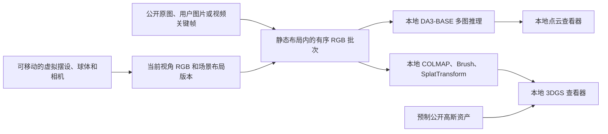

# 球形机器人离线空间扫描架构

2026 年 11 月 23 日 · 视觉验证阶段

在一台开发电脑上，用可操作的仿真场景和本地文件串起多视角采集、点云补扫、3DGS 重建及交互展示。视觉作业先独立验证，以命令行和本地查看器交接。正式工作台界面、任务服务、设备接入和云部署在视觉结果稳定后设计。[执行方案](offline-scan-execution-plan.md) · [项目总览](project-overview.md)

## 输入、作业与显示

| 路径 | 输入与处理 | 可检查的结果 |
| --- | --- | --- |
| 仿真取景 | 在桌面区域摆放或移动物体，控制球体及支架上的虚拟 RGB 相机，取当前相机实际渲染的像素。 | 球体位置、相机位置和画面一致。取景 RGB、机位和布局版本保存到本机。 |
| 点云补扫 | 同一静态布局中先拍少量相邻机位，再补侧面、背面及过渡视角。对每个批次的原图运行预训练 DA3-BASE 多图联合推理。 | 各批次的彩色点云 GLB 可独立对照，背面新增表面有原图可核对。需要检查前后层次时可额外导出深度热图。 |
| 3DGS 重建 | 仿真 RGB、公开原始照片和自有照片或视频关键帧均可从本地目录进入。COLMAP 注册相机，Brush 优化每个场景，SplatTransform 导出用于浏览的 SOG。 | 保存相机注册清单、完整高斯 PLY、SOG 与日志。在已拍摄覆盖的区域换视角，局部展品和室内场景各用对应素材验证。 |
| 预制场景浏览 | 将公开的高斯 PLY 或 SOG 预先准备好，用本地高斯查看器加载。 | 断外网后可浏览、转向和移动，记录格式、来源、版本与授权。 |

已拍摄批次保持几何布局不变。球体和相机换机位时，在同一布局下采集新照片。移动或增删参与重建的物体后，保存新布局快照并重新采集，旧布局的照片和产物仍可回看。仿真渲染应避免把跟随相机移动的球体或操作界面拍进重建输入。仿真位姿可用于对照，主流程凭 RGB 注册相机。[实施步骤](implementation-guide.md)

## 文件交接与验证

- 每次扫描保存素材来源、布局版本、机位、RGB 原图和有序批次清单。计算结果关联输入批次、配置和生成时间。失败重跑保留上一份有效产物。
- 点云预览和高斯重建各自读取已确认的原图批次。不同批次的相对尺度、坐标可能不同，未对齐时并排查看即可。
- 本地浏览分开测素材打开、首帧、首次拖动响应及连续换位的帧间隔。3DGS 计算分别计相机注册、优化和导出。全景式 3DGS 浏览允许在覆盖区域改变视点。已有球面全景图片适合在固定位置旋转查看。
- 公开照片已验证本地 DA3、COLMAP、Brush 和 SOG，离线单文件查看已验证。现有仿真原型能生成不同机位的 RGB。可移动布局、仿真新拍图片的完整闭环与用户自有素材待联调。[公开基准](../experiments/public-sample-benchmark.md)

## 后续平台和部署

视觉验证通过后，将本地文件约定封装为作业接口和统一查看入口。再决定是否接入实体球、把作业部署到有持久存储的 GPU 云服务器，并用已有域名发布工作台。实体球接入前验证摄像头清晰度、实际安装视角、取景位移和缓存重试。云端上线前验证无桌面 GPU 运行、结果可追溯和静态资产交付。部署规模见[技术调研](../research/spherical-robot-spatial-vision.md)。
